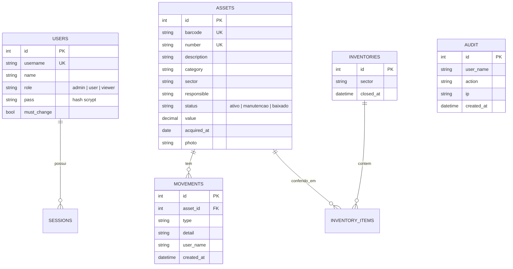

# Ligação com Banco de Dados — como seria na sua empresa

> **Demonstração.** O MVP usa **SQLite** (um arquivo local) para rodar em qualquer máquina sem instalar nada.
> Numa implementação real, o sistema é conectado ao **banco corporativo** da empresa (PostgreSQL, SQL Server, MySQL/MariaDB ou Oracle).
> Este documento mostra **como essa ligação é feita**. Os trechos de código abaixo são ilustrativos e não estão ativos no MVP.

Contato para implementação: **https://www.linkedin.com/in/rikelme-holanda-alves-ba1990288/**

---

## 1. Como é hoje (MVP)

```
Navegador ──HTTP/JSON──▶ server.js ──▶ SQLite (data/patrimonio.db)
                                  └──▶ data/photos/  (fotos dos bens)
```

- O servidor acessa o banco diretamente (`db.prepare(...)`) usando o módulo nativo `node:sqlite`.
- É simples e ótimo para demonstração, mas **não** é o modelo indicado para várias pessoas usando ao mesmo tempo, alta disponibilidade ou integração com outros sistemas.

## 2. Como fica na versão contratada

```
Navegador ──HTTPS──▶ API (Node.js) ──▶ Camada de dados (repositórios)
                                           │
                    ┌──────────────────────┼───────────────────────┐
                    ▼                      ▼                       ▼
            Banco corporativo        Armazenamento de fotos    ERP / RH / AD
        (PostgreSQL / SQL Server)     (S3, Azure Blob, NAS)    (integrações)
```

Mudanças principais:

1. **Camada de dados separada:** as consultas saem do `server.js` e vão para "repositórios". Trocar de banco passa a ser trocar um arquivo, sem reescrever as regras de negócio.
2. **Pool de conexões:** várias conexões reutilizadas, para suportar muitos usuários simultâneos.
3. **Credenciais fora do código:** usuário, senha e endereço do banco em variáveis de ambiente.
4. **Migrações versionadas:** alterações de estrutura controladas por scripts numerados.
5. **Fotos em armazenamento de objetos** (ou NAS) em vez de pastas locais, e o banco guarda só o caminho.

## 3. Modelo de dados (ER)



### Script de criação (PostgreSQL)

```sql
CREATE TABLE users (
  id           SERIAL PRIMARY KEY,
  username     VARCHAR(40)  NOT NULL UNIQUE,
  name         VARCHAR(80)  NOT NULL,
  role         VARCHAR(10)  NOT NULL CHECK (role IN ('admin','user','viewer')),
  pass         TEXT         NOT NULL,
  must_change  BOOLEAN      NOT NULL DEFAULT FALSE,
  created_at   TIMESTAMP    NOT NULL DEFAULT now()
);

CREATE TABLE assets (
  id           SERIAL PRIMARY KEY,
  barcode      VARCHAR(80)  NOT NULL UNIQUE,
  number       VARCHAR(40)  NOT NULL UNIQUE,
  description  VARCHAR(200) NOT NULL,
  category     VARCHAR(80)  NOT NULL DEFAULT '',
  sector       VARCHAR(80)  NOT NULL DEFAULT '',
  responsible  VARCHAR(80)  NOT NULL DEFAULT '',
  status       VARCHAR(12)  NOT NULL DEFAULT 'ativo'
               CHECK (status IN ('ativo','manutencao','baixado')),
  value        NUMERIC(14,2),
  acquired_at  DATE,
  photo        TEXT         NOT NULL DEFAULT '',
  notes        TEXT         NOT NULL DEFAULT '',
  created_at   TIMESTAMP    NOT NULL DEFAULT now(),
  updated_at   TIMESTAMP    NOT NULL DEFAULT now()
);

CREATE TABLE movements (
  id         SERIAL PRIMARY KEY,
  asset_id   INT          NOT NULL REFERENCES assets(id) ON DELETE CASCADE,
  type       VARCHAR(20)  NOT NULL,
  detail     TEXT         NOT NULL,
  note       TEXT         NOT NULL DEFAULT '',
  user_name  VARCHAR(80)  NOT NULL,
  created_at TIMESTAMP    NOT NULL DEFAULT now()
);

CREATE INDEX idx_assets_sector   ON assets(sector);
CREATE INDEX idx_assets_status   ON assets(status);
CREATE INDEX idx_movements_asset ON movements(asset_id);
```

> Em **SQL Server** troca-se `SERIAL` por `INT IDENTITY(1,1)`, `TIMESTAMP`/`now()` por `DATETIME2`/`SYSDATETIME()` e `BOOLEAN` por `BIT`. Em **MySQL**, `SERIAL` por `INT AUTO_INCREMENT`.

## 4. Exemplo de conexão (PostgreSQL com `pg`)

**Variáveis de ambiente** (`.env`, nunca versionado):

```
DB_HOST=db.suaempresa.local
DB_PORT=5432
DB_NAME=patrimonio
DB_USER=app_patrimonio
DB_PASSWORD=********
DB_SSL=true
```

**`db/pool.js`**

```js
const { Pool } = require('pg');

module.exports = new Pool({
  host: process.env.DB_HOST,
  port: Number(process.env.DB_PORT) || 5432,
  database: process.env.DB_NAME,
  user: process.env.DB_USER,
  password: process.env.DB_PASSWORD,
  ssl: process.env.DB_SSL === 'true' ? { rejectUnauthorized: true } : false,
  max: 10,                    // conexões simultâneas
  idleTimeoutMillis: 30000,
});
```

**`db/assets.repository.js`** (a única parte que "fala SQL" com patrimônios)

```js
const pool = require('./pool');

// Sempre consultas parametrizadas ($1, $2...) — protege contra SQL injection.
exports.findByCode = async (code) => {
  const { rows } = await pool.query(
    'SELECT * FROM assets WHERE barcode = $1 OR number = $1', [code]);
  return rows[0] || null;
};

exports.create = async (a, user) => {
  const client = await pool.connect();
  try {
    await client.query('BEGIN');                       // transação
    const { rows } = await client.query(
      `INSERT INTO assets (barcode, number, description, category, sector, responsible, status, value, acquired_at)
       VALUES ($1,$2,$3,$4,$5,$6,$7,$8,$9) RETURNING *`,
      [a.barcode, a.number, a.description, a.category, a.sector, a.responsible, a.status, a.value, a.acquired_at || null]);
    await client.query(
      `INSERT INTO movements (asset_id, type, detail, user_name) VALUES ($1,'cadastro',$2,$3)`,
      [rows[0].id, 'Cadastrado', user.name]);
    await client.query('COMMIT');
    return rows[0];
  } catch (e) {
    await client.query('ROLLBACK');                    // tudo ou nada
    throw e;
  } finally {
    client.release();
  }
};
```

**Uso na rota** (a regra de negócio não conhece o banco):

```js
const assets = require('./db/assets.repository');
// POST /api/assets
const created = await assets.create(validated, user);
```

## 5. Migração dos dados do MVP

1. Exportar do SQLite (ou do CSV do próprio sistema).
2. Carregar no banco novo com `COPY` (PostgreSQL) / `BULK INSERT` (SQL Server) ou pelo importador de planilhas do sistema.
3. Conferir totais (quantidade de bens, soma de valores) entre origem e destino.
4. Virar a chave: apontar as variáveis de ambiente para o novo banco.

## 6. Integração com outros sistemas da empresa

| Integração | Como é feita |
|---|---|
| **ERP / contabilidade** | Leitura de bens e centros de custo por *view*, API ou tabela de integração; sincronização agendada. |
| **RH / Active Directory** | Importar responsáveis e setores; login único (SSO/LDAP) no lugar de senhas locais. |
| **Planilhas** | Importação e exportação (já existe CSV no MVP). |
| **Fotos** | Armazenamento em S3, Azure Blob ou servidor de arquivos; o banco guarda somente a referência. |

## 7. Segurança e operação no banco

- Usuário do banco **exclusivo da aplicação**, com apenas as permissões necessárias (nunca o administrador do banco).
- Conexão **criptografada (TLS)** e banco fora da internet pública.
- **Backups automáticos** com teste periódico de restauração.
- **Auditoria** gravada em tabela própria (já existe no MVP) e, se preciso, também no nível do banco.
- Índices e acompanhamento de desempenho para bases grandes.
- Adequação à **LGPD** (dados de responsáveis e usuários).

---

*Este é um MVP de demonstração. A arquitetura de dados definitiva é definida junto com a equipe de TI da empresa contratante.*
